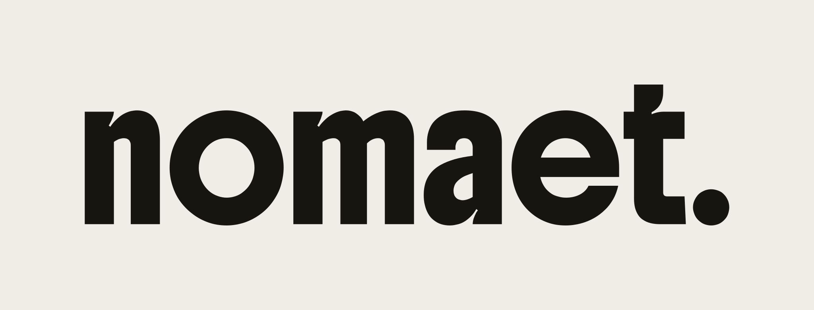

<p align="center"></p>

<p align="center"><b>Made to stay. No matter what.</b></p>

# NOMAETstudios Design

Die eine Quelle für alles, was nach nomaet. aussehen und klingen soll: Logo, Farben, Schriften, Regeln und Marketing-Kontext.

| Ordner / Datei | Inhalt |
|---|---|
| [`BRAND.md`](BRAND.md) | Markenhandbuch: Logo, Farbe, Schrift, Archiv-Elemente, Bildsprache, Sprache, Schnellcheck |
| [`brand.html`](brand.html) | Visuelle Übersicht zum Durchklicken (im Browser öffnen) |
| [`logo/`](logo) | Wortmarke **nomaet.** und Zeichen **n.** als SVG (Vektor) und PNG |
| [`tokens/`](tokens) | Design-Tokens als JSON und CSS (für Shop, Landingpages, Mails) |
| [`fonts/`](fonts) | Boldonse, Inter Tight, Inter (Open Font License) |
| [`.agents/product-marketing.md`](.agents/product-marketing.md) | Marken-Kontext, den die Marketing-Skills lesen |
| [`marketing/skills/`](marketing) | Marketing-Skills (coreyhaines31/marketingskills, MIT) als Submodul |
| [`CLAUDE.md`](CLAUDE.md) | Arbeitsanweisung für Claude in diesem Repo |

## Kurz und knapp

- **Logo:** nur `nomaet.` in Boldonse. Boldonse nirgends sonst.
- **Farben:** Papier `#EFEDE6` · Tinte `#16150F` · Stempelblau `#2C3E8F` (max. 10 %) · Grau `#6B6A62` · Sand `#D8C9A0`
- **Schrift:** Inter Tight für Überschriften und Etiketten, Inter für Text.
- **Archiv:** höchstens ein Archiv-Element pro Screen. Nummern immer: `chapter 01 · no 001`.

## Klonen

```bash
git clone --recurse-submodules https://github.com/<user>/nomaet-design.git
```

Marketing-Skills aktualisieren:

```bash
git submodule update --remote marketing/skills
```

## Lizenzen

Logo und Markenregeln: © NOMAETstudios, alle Rechte vorbehalten.
Schriften: SIL Open Font License 1.1 (siehe `fonts/OFL-*.txt`).
Marketing-Skills: MIT, © Corey Haines.
